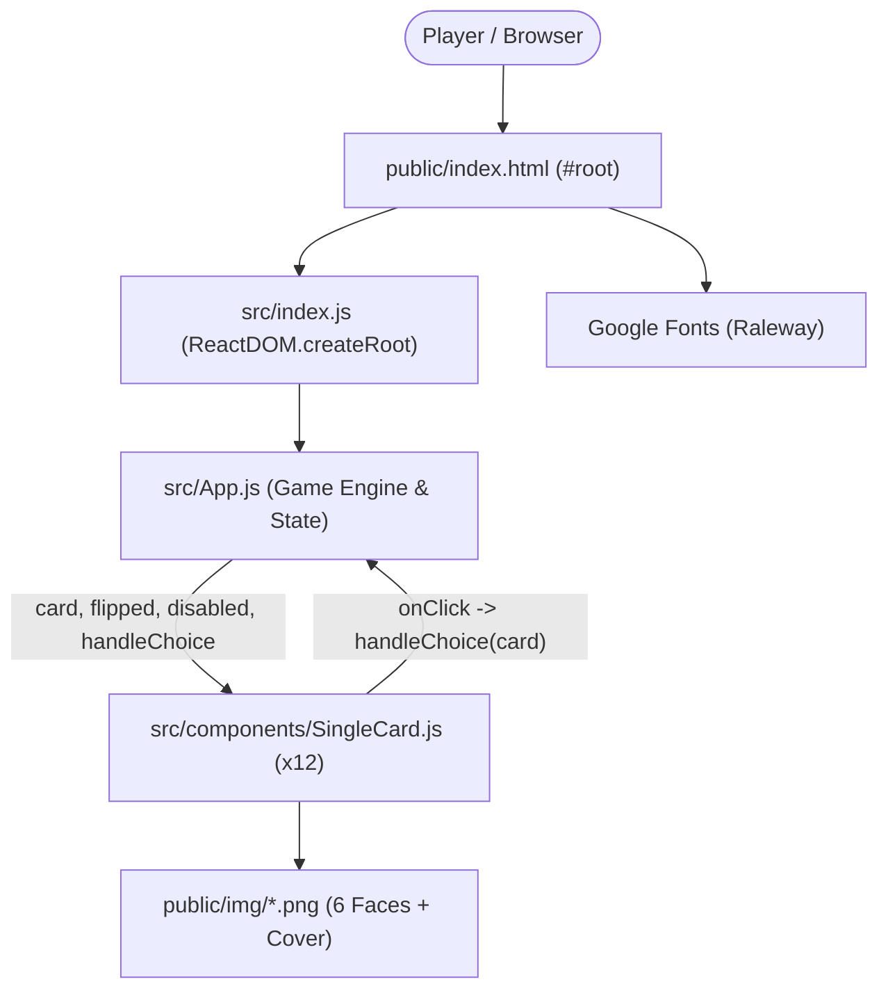
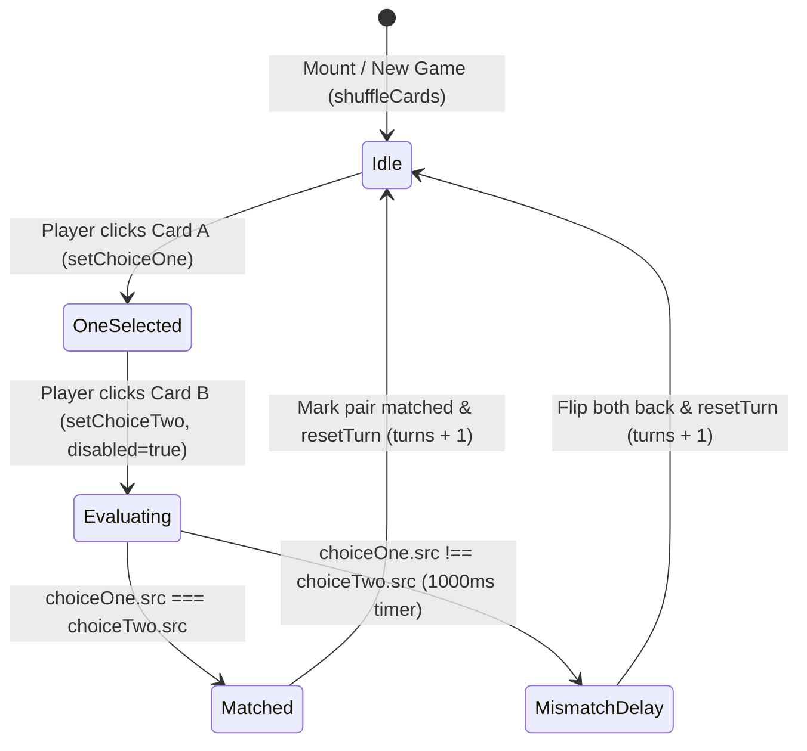

# Magic Match

[](./.github/workflows/ci.yml)
[](https://react.dev/)
[](./LICENSE)
[](https://www.conventionalcommits.org/)

**Magic Match** is a browser-based memory card matching game built with React 18. Players flip pairs of fantasy-themed cards on a 4×3 grid to uncover all 6 matching pairs in as few turns as possible, featuring smooth CSS 3D flip transitions, automatic turn locking during pair evaluation, and instant deck reshuffling.

---

## ⚡ Quick Start

Boot the local development server in 3 commands:

```bash
# 1. Clone the repository
git clone https://github.com/digitalterrene/magic-match.git
cd magic-match

# 2. Install dependencies
npm install

# 3. Start the development server
npm start
```

Open [http://localhost:3000](http://localhost:3000) in your browser. The app hot-reloads on source edits.

---

## 🏗️ System Architecture

Magic Match follows a unidirectional data-flow architecture where `App` owns the canonical game state and `SingleCard` renders stateless, CSS-animated card views.



### Turn & Match Resolution Lifecycle



---

## 📚 Documentation Map (4-Tier Architecture)

This repository follows the **4-Tier Senior Documentation Architecture**:

| Tier | Document | Purpose |
|---|---|---|
| **Tier 1: Root & Governance** | [`README.md`](./README.md), [`CONTRIBUTING.md`](./CONTRIBUTING.md), [`SECURITY.md`](./SECURITY.md), [`LICENSE`](./LICENSE) | Onboarding, contribution rules, security policy, and license |
| **Tier 1: Engineering Rules** | [`docs/git-standards.md`](./docs/git-standards.md) | Branching, Conventional Commits, CoT guidelines, and quality gates |
| **Tier 2: Architecture** | [`docs/architecture/system-design.md`](./docs/architecture/system-design.md) | Component topology, sequence diagrams, state machine, and CSS 3D flip mechanics |
| **Tier 2: Data Model** | [`docs/architecture/data-model.md`](./docs/architecture/data-model.md) | Client-side state schemas, card deck inventory, and state invariants |
| **Tier 2: Security** | [`docs/architecture/security.md`](./docs/architecture/security.md) | Trust boundaries, SPA threat model, supply-chain hygiene, and static hosting headers |
| **Tier 3: ADRs** | [`docs/adr/README.md`](./docs/adr/README.md) | Immutable Architecture Decision Records (ADR-001 through ADR-003) |
| **Tier 4: Runbooks** | [`docs/runbooks/deployment-verification.md`](./docs/runbooks/deployment-verification.md) | Static build verification, asset checks, and rollback procedures |
| **Tier 4: Incident Triage** | [`docs/runbooks/incident-response.md`](./docs/runbooks/incident-response.md) | Triage flowcharts for runtime issues, asset failures, and CVEs |

---

## 🛠️ Tech Stack & Repository Structure

| Layer | Technology | Version |
|---|---|---|
| **UI Framework** | React & React DOM | `18.2.0` |
| **Build & Dev Tooling** | Create React App (`react-scripts`) | `5.0.1` |
| **Styling** | Vanilla CSS (CSS Grid, 3D Transforms) + Raleway Font | CSS3 |
| **Testing** | Jest + React Testing Library | `13.3.0` |
| **CI/CD** | GitHub Actions + Gitleaks | Workflow v1 |

```text
magic-match/
├── .github/
│   ├── ISSUE_TEMPLATE/          # Bug report & feature request forms
│   ├── workflows/ci.yml         # Automated secret scan, test & build gate
│   └── PULL_REQUEST_TEMPLATE.md # Standardized PR verification template
├── docs/
│   ├── architecture/            # System design, data model, and security specs
│   ├── adr/                     # Architecture Decision Records & template
│   ├── runbooks/                # Deployment verification & incident response
│   └── git-standards.md         # Git hygiene & Conventional Commit rules
├── public/
│   ├── img/                     # Card artwork (6 faces + cover.png)
│   ├── index.html               # HTML shell & #root mount point
│   └── manifest.json            # Web app manifest
├── src/
│   ├── components/
│   │   ├── SingleCard.js        # Presentational flip-card component
│   │   └── SingleCard.css       # 3D rotateY flip transition styles
│   ├── App.js                   # Core game state, shuffle & match engine
│   ├── App.css                  # Layout, button & 4-column card grid styles
│   ├── App.test.js              # Component unit test suite
│   ├── index.js                 # React 18 root bootstrapper
│   └── index.css                # Global typography & dark theme styles
├── CONTRIBUTING.md
├── LICENSE
├── SECURITY.md
└── package.json
```

---

## 🧪 Available Scripts & Verification

```bash
# Start local development server (http://localhost:3000)
npm start

# Run interactive test watcher (or CI=true npm test for single-pass)
npm test

# Build optimized static production bundle into ./build
npm run build
```

---

## 🤝 Contributing

We welcome contributions! Please review our [Contributing Guidelines](./CONTRIBUTING.md) and [Git Engineering Standards](./docs/git-standards.md) before opening a Pull Request.

---

## 🛡️ Security

To report a security vulnerability, please follow the responsible disclosure process in [`SECURITY.md`](./SECURITY.md).

---

## 📄 License

This repository is licensed under the [MIT License](./LICENSE).
