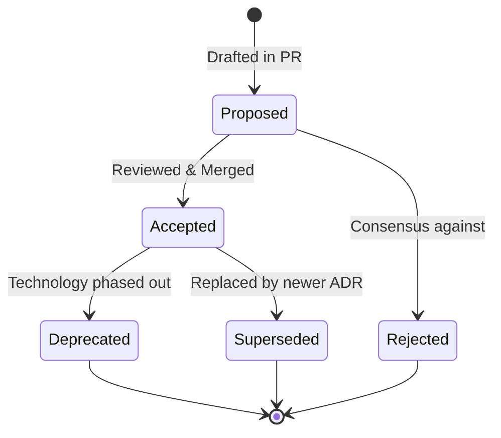

# Architecture Decision Records (ADRs)

This directory contains immutable records of architecturally significant technical decisions for **Magic Match**.

## ADR Index

| ADR | Title | Status | Date |
|---|---|---|---|
| [ADR-000](./ADR-000-template.md) | Architecture Decision Record Template | Template | 2026-11-21 |
| [ADR-001](./ADR-001-react-spa-local-state-architecture.md) | React 18 Client-Side SPA with Local Hook State | Accepted | 2026-11-21 |
| [ADR-002](./ADR-002-css-3d-transform-card-flip-animation.md) | Pure CSS 3D `rotateY` Card Flip Animations | Accepted | 2026-11-21 |
| [ADR-003](./ADR-003-static-public-asset-serving-and-deck-shuffling.md) | Static Public Asset Serving & In-Memory Deck Shuffling | Accepted | 2026-11-21 |

---

## ADR Lifecycle

## Creating a New ADR

1. Copy [`ADR-000-template.md`](./ADR-000-template.md) to `ADR-00X-short-kebab-title.md`.
2. Fill in Context, Decision, Consequences, and Alternatives Considered.
3. Add a row to the **ADR Index** table above and submit via Pull Request.
