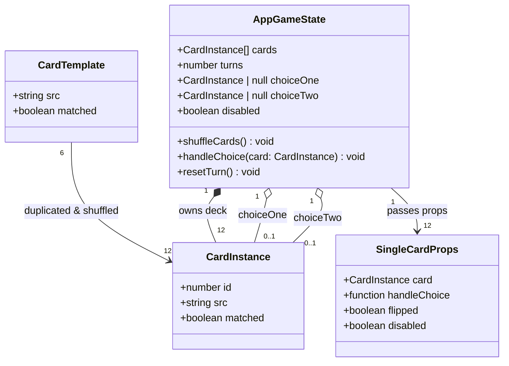
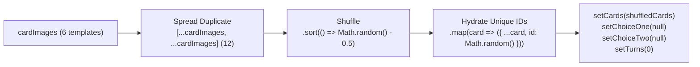

# Data Models & Client-Side State Schema

*Status*: Living Architecture Specification  
*Last Updated*: 2026-11-21

---

## 1. Overview

Magic Match stores all runtime state exclusively in React component memory (`src/App.js`). There is no relational database, NoSQL store, or `localStorage` persistence layer. Every game session begins from a static 6-card template array that is duplicated into a 12-card active deck.

---

## 2. State & Props Entity Diagram



---

## 3. State Field Specifications (`App.js`)

| State Variable | Type | Initial Value | Mutators | Invariants |
|---|---|---|---|---|
| `cards` | `CardInstance[]` | `[]` (populated to 12 on mount) | `setCards` | Always contains 12 items (6 matched pairs by `src`) after initial mount. |
| `turns` | `number` | `0` | `setTurns` | Non-negative integer; increments by `1` per completed 2-card comparison; resets to `0` on `shuffleCards()`. |
| `choiceOne` | `CardInstance \| null` | `null` | `setChoiceOne` | Reference to the first card selected in the active turn. |
| `choiceTwo` | `CardInstance \| null` | `null` | `setChoiceTwo` | Reference to the second card selected; only populated when `choiceOne` is non-null. |
| `disabled` | `boolean` | `false` | `setDisabled` | `true` while both `choiceOne` and `choiceTwo` are non-null (blocks third-card clicks during evaluation/delay). |

### Derived State (`SingleCard` Prop)

- `flipped: boolean` is computed dynamically during render rather than stored redundantly:
  ```javascript
  flipped = card === choiceOne || card === choiceTwo || card.matched
  ```
  This guarantees a single source of truth between active selections, matched status, and visual card orientation.

---

## 4. Deck Generation Pipeline



---

## 5. Static Card Asset Inventory (`public/img/`)

All card imagery is served as static PNG files from `public/img/` relative to the web root:

| Asset Path | Role | Pair Count in Deck | File Size |
|---|---|---|---|
| `/img/cover.png` | Shared card back (face-down) | Used on all 12 cards | ~50.0 KB |
| `/img/helmet-1.png` | Card face: Helmet | 2 instances | ~41.3 KB |
| `/img/potion-1.png` | Card face: Potion | 2 instances | ~40.0 KB |
| `/img/ring-1.png` | Card face: Ring | 2 instances | ~26.0 KB |
| `/img/scroll-1.png` | Card face: Scroll | 2 instances | ~34.1 KB |
| `/img/shield-1.png` | Card face: Shield | 2 instances | ~46.7 KB |
| `/img/sword-1.png` | Card face: Sword | 2 instances | ~30.2 KB |

> [!TIP]
> When adding new card themes or difficulty levels (e.g., 8 pairs / 4×4 grid), add PNG assets to `public/img/` and register them in the `cardImages` constant in `src/App.js`.
