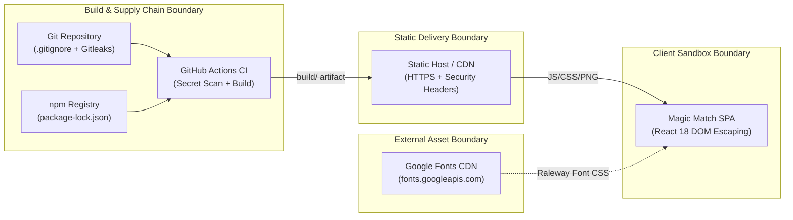

# Security Architecture & Trust Boundaries

*Status*: Living Architecture Specification  
*Last Updated*: 2026-11-21

---

## 1. Security Posture Overview

**Magic Match** is a **client-side React Single-Page Application (SPA)** executed entirely inside the user's browser. All game state lives transiently in React component memory. The primary security surface consists of **static asset delivery**, **browser execution integrity**, **npm supply-chain hygiene**, and **CI/CD secret protection**.

---

## 2. Trust Boundary Diagram

---

## 3. Client-Side & Supply Chain Controls

1. **XSS Prevention**:
   - React's JSX rendering automatically escapes all dynamic values (`{turns}`).
   - `dangerouslySetInnerHTML` is prohibited across the codebase.
   - Card image paths (`card.src`) originate exclusively from the static `cardImages` array in `src/App.js`, never from URL parameters or user input.
2. **Dependency Hygiene**:
   - `package-lock.json` is committed to enforce deterministic dependency resolution (`npm ci` in CI).
   - Run `npm audit` periodically and monitor advisories for `react-scripts` (Create React App 5) transitive dependencies.
3. **Zero-Leak Repository Hygiene**:
   - Hardened `.gitignore` prevents accidental commits of private keys, credentials, and runtime logs.
   - `.github/workflows/ci.yml` runs **Gitleaks** across git history on every push and Pull Request.

---

## 4. Recommended Production HTTP Security Headers

When deploying the compiled `build/` directory to a static host (Vercel, Netlify, Cloudflare Pages, Nginx, or S3 + CloudFront), configure the following response headers:

| Header | Recommended Value | Purpose |
|---|---|---|
| `Content-Security-Policy` | `default-src 'self'; style-src 'self' 'unsafe-inline' https://fonts.googleapis.com; font-src 'self' https://fonts.gstatic.com; img-src 'self' data:; script-src 'self'; frame-ancestors 'none';` | Restricts script/asset origins while permitting Google Fonts (`Raleway`) |
| `X-Content-Type-Options` | `nosniff` | Prevents MIME-type sniffing |
| `X-Frame-Options` | `DENY` | Prevents clickjacking embeds |
| `Referrer-Policy` | `strict-origin-when-cross-origin` | Limits referrer leakage to third-party font CDNs |
| `Strict-Transport-Security` | `max-age=31536000; includeSubDomains` | Enforces HTTPS on custom domains |
