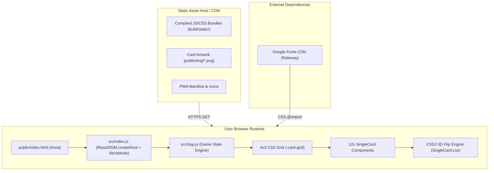
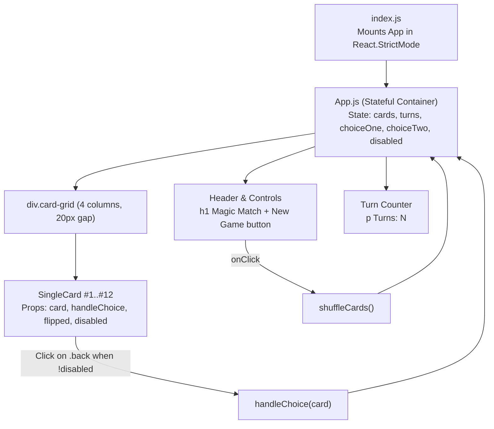
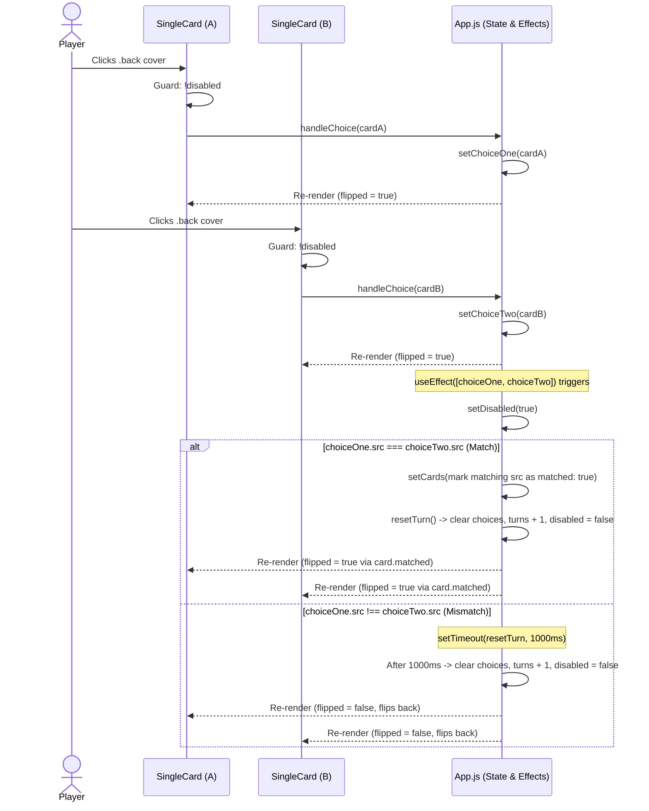
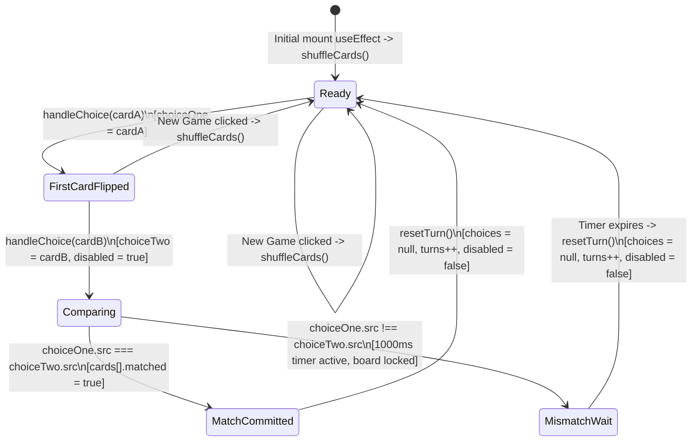
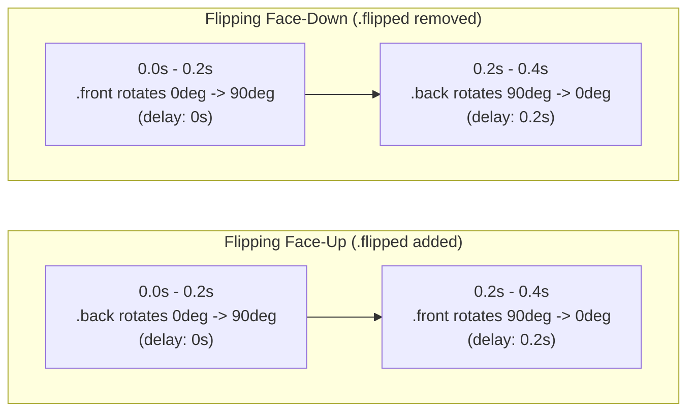

# System Design & Component Topology

*Status*: Living Architecture Specification  
*Last Updated*: 2026-11-21

---

## 1. Executive Summary

**Magic Match** is a zero-backend, client-side Single-Page Application (SPA) built on **React 18.2** and **Create React App (`react-scripts` 5.0.1)**. All game logic, deck shuffling, turn tracking, pair comparison, and 3D card-flip animations execute locally in the user's browser with zero network calls after initial static asset delivery.

---

## 2. Deployment & Runtime Topology

---

## 3. Component Hierarchy & Data Flow

Magic Match enforces a strict **unidirectional data flow** (top-down props, bottom-up event callbacks):

### Component Responsibilities

| Component | File | Type | Responsibilities |
|---|---|---|---|
| **Root Bootstrap** | `src/index.js` | Entrypoint | Creates React 18 root on `#root` and wraps `<App />` in `<React.StrictMode>`. |
| **Game Engine** | `src/App.js` | Stateful Container | Owns deck generation (`shuffleCards`), selection state (`choiceOne`, `choiceTwo`), comparison effect, input lock (`disabled`), and turn counter (`turns`). |
| **Card View** | `src/components/SingleCard.js` | Presentational | Renders `.front` (card face) and `.back` (`cover.png`), applies `.flipped` class, and guards click events against `disabled`. |

---

## 4. Card Selection & Match Resolution Sequence

The following sequence diagram traces both **Match** and **Mismatch** paths from user click through React state updates and `useEffect` reconciliation:

---

## 5. Turn State Machine

---

## 6. CSS 3D Card Flip Mechanics

Card flips in `src/components/SingleCard.css` are driven purely by CSS `transform: rotateY(...)` and staggered `transition-delay` values—requiring zero JavaScript animation libraries:

| Selector | Default Transform | Flipped Transform | Transition Duration | Transition Delay |
|---|---|---|---|---|
| `.card .front` | `rotateY(90deg)` (hidden edge-on) | `rotateY(0deg)` (visible) | `0.2s ease-in` | `0s` (closing) / `0.2s` (opening) |
| `.card .back` | `rotateY(0deg)` (visible) | `rotateY(90deg)` (hidden edge-on) | `0.2s ease-in` | `0.2s` (closing) / `0s` (opening) |

---

## 7. Known Architectural Constraints & Improvement Roadmap

Documented honestly from the current implementation (`v0.1.0`):

1. **Shuffle Bias**: `shuffleCards()` currently uses `.sort(() => Math.random() - 0.5)`, which produces a non-uniform distribution across JS engines. *Recommended upgrade*: Fisher-Yates shuffle.
2. **Timer Cleanup on Reset**: Clicking **New Game** during a 1000ms mismatch delay does not cancel the pending `setTimeout`, which could increment `turns` on the new game. *Recommended upgrade*: Store timeout ID in a `useRef` or return a cleanup function from `useEffect`.
3. **Diagnostic Logging**: `src/App.js` currently logs `console.log(cards)` on every render. *Recommended upgrade*: Remove before production release.
4. **Placeholder Unit Test**: `src/App.test.js` still contains the default Create React App test (`/learn react/i`). *Recommended upgrade*: Replace with game-behavior tests (grid renders 12 cards, matching pair increments turns, New Game resets turns).
5. **Victory Detection**: No explicit game-completion banner when all 6 pairs are matched (`cards.every(c => c.matched)`).
