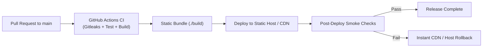

# Deployment Verification Runbook

*Tier 4 Operational Runbook* — Step-by-step build, smoke-test, and rollback verification procedures for **Magic Match** static SPA releases.

---

## 1. Release & Deployment Flow



---

## 2. Pre-Deployment Build Verification (Local / CI)

Run these commands from the repository root before promoting a build:

```bash
# 1. Clean install from lockfile
npm ci

# 2. Run unit test suite in non-interactive CI mode
CI=true npm test -- --watchAll=false

# 3. Build optimized production bundle
npm run build

# 4. Verify all 7 required card artwork assets are present in build/img/
ls -la build/img/
```

Expected assets in `build/img/`:
- `cover.png`
- `helmet-1.png`
- `potion-1.png`
- `ring-1.png`
- `scroll-1.png`
- `shield-1.png`
- `sword-1.png`

---

## 3. Post-Deployment Smoke Test Checklist

Replace `<DEPLOY_URL>` with the target deployment URL (e.g., `https://magic-match.example.com`):

- [ ] **Root HTML Availability**: `curl -fsI <DEPLOY_URL>/` returns `HTTP 200` with `Content-Type: text/html`.
- [ ] **Card Asset Integrity**: `curl -fsI <DEPLOY_URL>/img/cover.png` returns `HTTP 200` with `Content-Type: image/png`.
- [ ] **Grid Render Check**: Page renders title **Magic Match**, **New Game** button, 12 face-down cards in a 4×3 grid, and `Turns: 0`.
- [ ] **Gameplay Flow Check**:
  - Clicking two non-matching cards flips both face-up, locks board for 1 second, flips both back, and increments `Turns` to `1`.
  - Clicking two matching cards keeps both face-up and increments `Turns`.
  - Clicking **New Game** reshuffles all 12 cards face-down and resets `Turns` to `0`.
- [ ] **Browser Console Hygiene**: Zero uncaught runtime errors or 404 asset requests in DevTools Network/Console tabs.
- [ ] **Security Headers Check**: Verify `X-Content-Type-Options`, `X-Frame-Options`, and `Content-Security-Policy` headers via `curl -I <DEPLOY_URL>/`.

---

## 4. Rollback Procedure

Because Magic Match is a stateless static bundle with no database migrations, rollbacks are instantaneous and non-destructive:

1. **Managed Static Host (Vercel / Netlify / Cloudflare Pages)**: Promote the previous known-good deployment in the hosting dashboard or CLI.
2. **Git-Driven Redeploy**: Revert the offending commit on `main` using a Conventional Commit (`revert: ...`) and allow CI to rebuild and deploy.
3. **CDN Cache Purge**: Invalidate `index.html` at the CDN edge so returning clients immediately fetch the restored bundle hash.
