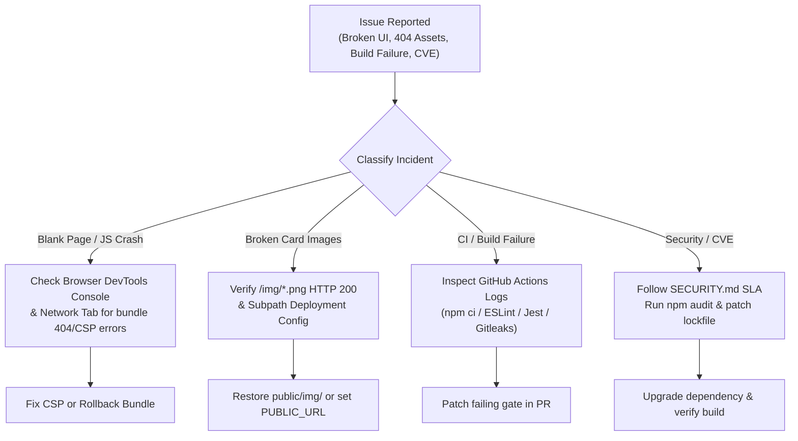

# Incident Response & Triage Runbook

*Tier 4 Operational Runbook* — Rapid diagnosis and remediation procedures for **Magic Match** runtime, asset, build, and security incidents.

---

## 1. Incident Triage Flowchart



---

## 2. Common Failure Playbooks

### Playbook A: Card Images Return HTTP 404
- **Symptoms**: Broken image icons on the 4×3 grid; DevTools Network tab shows `404` for `/img/cover.png` or `/img/helmet-1.png`.
- **Root Causes**:
  1. App was deployed to a subpath (e.g., `https://user.github.io/magic-match/`) while `App.js` and `SingleCard.js` reference root-relative `/img/...`.
  2. `public/img/` files were omitted during a custom build/copy step.
- **Remediation**:
  - For root-domain deployments: confirm `build/img/` contains all 7 PNGs and redeploy.
  - For subpath deployments: set `"homepage"` in `package.json` and prefix paths with `process.env.PUBLIC_URL`.

### Playbook B: Blank Screen or CSP Violations
- **Symptoms**: White/dark empty page; DevTools Console reports `Refused to load stylesheet` or `Refused to execute script`.
- **Root Causes**:
  1. Overly restrictive `Content-Security-Policy` blocking `fonts.googleapis.com` / `fonts.gstatic.com` or inline styles.
  2. Stale `index.html` cached at CDN pointing to deleted hashed JS chunks.
- **Remediation**:
  - Align CSP header with [`docs/architecture/security.md`](../architecture/security.md).
  - Purge CDN cache for `index.html` (`Cache-Control: no-cache` recommended for `index.html`, immutable caching for `static/`).

### Playbook C: CI Quality Gate Failure
- **Gitleaks Failure**: Immediately revoke any exposed token/key, remove it from git history (`git filter-repo`), and update `.gitignore`.
- **Test Failure (`npm test`)**: Run `CI=true npm test -- --watchAll=false` locally to reproduce and fix before re-pushing.
- **Build Failure (`npm run build`)**: In CI (`CI=true`), Create React App treats ESLint warnings as build-breaking errors. Fix all ESLint warnings cleanly rather than disabling rules.

### Playbook D: Dependency Vulnerability (CVE)
1. Inspect advisories:
   ```bash
   npm audit
   ```
2. Apply non-breaking patches:
   ```bash
   npm audit fix
   ```
3. Re-verify tests and production build:
   ```bash
   CI=true npm test -- --watchAll=false && npm run build
   ```
4. Commit updated `package.json` / `package-lock.json` using `chore(deps): patch <advisory-summary>`.
